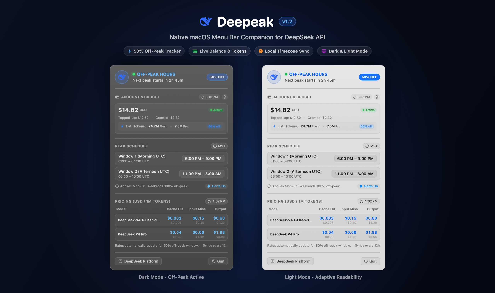
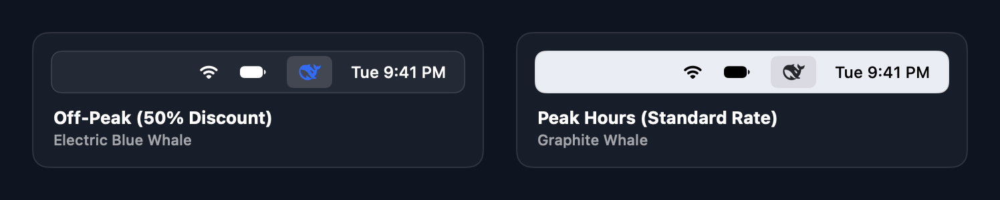
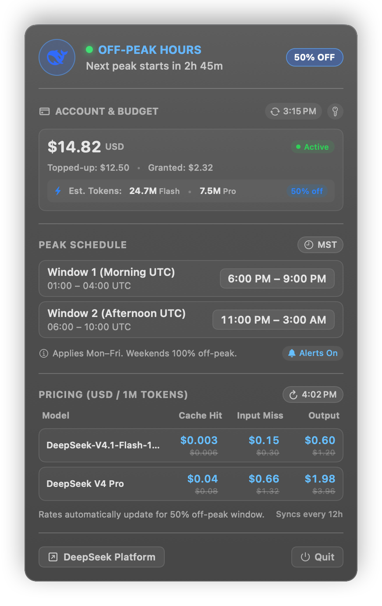
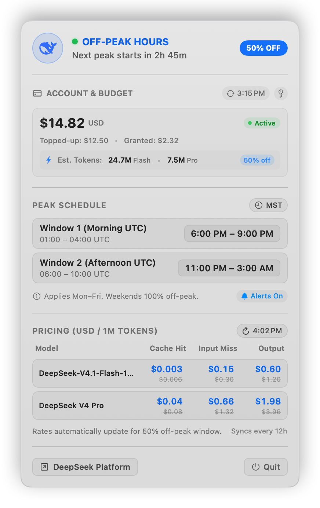
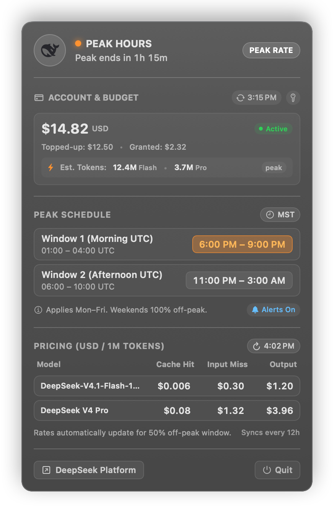
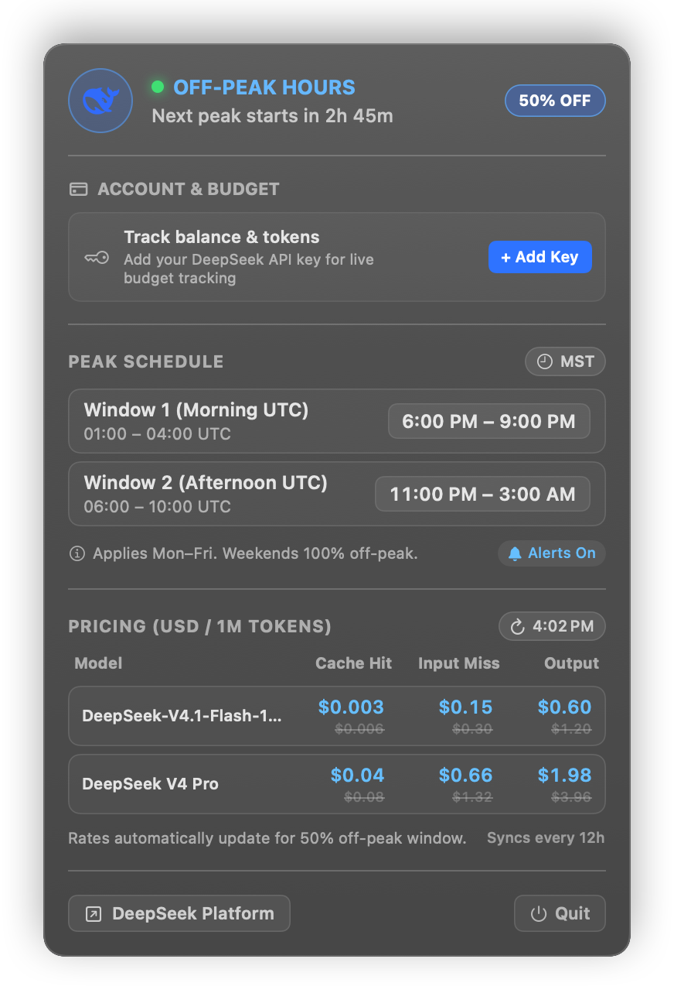

<h1 align="center">
   Deepeak
</h1>

<p align="center">
  <b>A polished, ultra-lightweight macOS menu bar tool for DeepSeek.</b><br/>
  Tracks live API peak & off-peak discount hours, converts schedules to your local system timezone, sends transition notifications, tracks live balances, and provides real-time token pricing.
</p>

<p align="center">
  
  
  
  
  
</p>

<p align="center">
  
</p>

---

## 📸 Screenshots

<p align="center">
  
</p>

<details>
<summary><b>View All States (Dark Mode, Light Mode, Peak Hours, Setup)</b></summary>
<br/>
<table align="center">
  <tr>
    <td align="center"><b>Dark Mode (Off-Peak)</b></td>
    <td align="center"><b>Light Mode (Off-Peak)</b></td>
  </tr>
  <tr>
    <td></td>
    <td></td>
  </tr>
  <tr>
    <td align="center"><b>Peak Hours Active</b></td>
    <td align="center"><b>First-Time API Key Setup</b></td>
  </tr>
  <tr>
    <td></td>
    <td></td>
  </tr>
</table>
</details>

---

## ✨ Features

- **🐋 Dynamic Menu Bar Icon**:
  - Displays the official **DeepSeek Whale logo** in the macOS menu bar.
  - Automatically turns **Electric Blue** during **Off-Peak (50% discount)** hours.
  - Automatically turns **Graphite / Black** during **Peak** hours.

- **⏰ System Timezone Sync & Countdown**:
  - DeepSeek API official schedule (Monday–Friday UTC):
    - **Window 1**: `01:00 – 04:00 UTC`
    - **Window 2**: `06:00 – 10:00 UTC`
    - **Off-Peak (50% Discount)**: All other hours, plus **100% of weekends** (Saturday & Sunday UTC).
  - Automatically translates UTC intervals into your Mac's current local system timezone.
  - Dynamically updates upon system timezone or clock adjustments (`NSSystemTimeZoneDidChange`).
  - Real-time countdown displaying remaining time until the next peak or off-peak transition.

- **🔔 Peak / Off-Peak Transition Notifications**:
  - Integrated with modern macOS **User Notifications** (`UNUserNotificationCenter`).
  - Sends immediate system alerts when entering **Off-Peak hours (50% discount active)** or returning to **Peak hours**.
  - Perfect for scheduling automated batch jobs, fine-tuning scripts, and high-throughput inference at minimum cost.

- **🚀 DeepSeek-V4.1-Flash-1017 & V4 Pro Support**:
  - Full support for **DeepSeek-V4.1-Flash-1017**.
  - Full support for **DeepSeek V4 Pro** (`deepseek-pro`, alias `deepseek-v4-pro`), the premier professional reasoning and code generation model.

- **💰 Real-Time Token Pricing Breakdown (USD / 1M Tokens)**:
  - Full rates breakdown for **Cache Hit**, **Input Miss**, and **Output** tokens.
  - Real-time 50% off-peak rate calculation with strikethrough comparison against standard peak pricing.
  - Background auto-refresh every **12 hours** with an instant manual refresh trigger.
  
- **💳 Live Account Balance & Budget**:
  - Connect your DeepSeek API key for real-time account balance tracking directly from DeepSeek's official `/user/balance` API.
  - Displays total balance, topped-up credits, and promotional grants in USD / CNY.
  - Smart status indicators: `Active`, `Low Balance`, or `Zero`.
  - Secure local credential storage via the macOS Keychain (`KeychainHelper`).

- **⚡ Dynamic Token Capacity Estimation**:
  - Automatically estimates remaining token generation capacity based on your current balance for both **DeepSeek-V4.1-Flash-1017** and **DeepSeek V4 Pro**.
  - Recalculates token purchasing power in real time when 50% off-peak discounts kick in.

- **🌿 Featherweight & Resource Conscious**:
  - Entire standalone app bundle is only **~600 KB** on disk.
  - **Lazy Popover Allocation**: View hierarchy and window backing stores are torn down immediately on dismiss.
  - Zero idle CPU wakes; negligible memory footprint.
  - Pure menu bar utility (`LSUIElement=true`) with no dock clutter.

### Architectural Highlights
- **MainActor Isolation**: UI-bound state and `@Published` properties across `ScheduleManager`, `PricingManager`, and `BalanceManager` are `@MainActor`-isolated to ensure thread safety.
- **Weak Capture Semantics**: Timers and async tasks use `[weak self]` capture semantics to guarantee zero retain cycles or memory leaks.
- **Modern Notification System**: Schedule alerts utilize `UNUserNotificationCenter` instead of deprecated `NSUserNotification` APIs.
- **Clean Lifecycle**: Popovers are lazily initialized upon click and immediately deallocated upon dismissal to conserve system resources.

---

## 🚀 Installation & Building

### Option 1: Direct Download (Recommended)
1. Download the latest **[Deepeak.dmg](https://github.com/lucentxo/Deepeak/releases/latest/download/Deepeak.dmg)** from [Releases](https://github.com/lucentxo/Deepeak/releases/latest).
2. Open `Deepeak.dmg` and drag **Deepeak** into your **Applications** folder.
3. Launch `Deepeak` — the whale logo will appear directly in your macOS menu bar!

---

### Option 2: Build from Source

Compile and package using the included `build.sh` script:

```bash
git clone https://github.com/lucentxo/Deepeak.git
cd Deepeak

# Build release .app bundle
./build.sh

# Run tests and create distributable DMG & ZIP
./build.sh --clean --test --dmg

# Launch the app
open Deepeak.app
```

### `build.sh` Command Line Options

| Flag | Description |
| :--- | :--- |
| `--clean` | Cleans previous build artifacts (`.build`, `Deepeak.app`, `Deepeak.dmg`, `Deepeak.zip`). |
| `--test`, `-t` | Executes `swift test` before building. |
| `--dmg` | Packages the compiled `.app` into a distributable `Deepeak.dmg` and compressed `.zip`. |
| `--debug` | Compiles using the debug configuration (default is release). |
| `--release` | Compiles using the release configuration. |
| `--run` | Launches `Deepeak.app` immediately after a successful build. |
| `--help`, `-h` | Displays usage and available options. |

---

## 📄 License

Distributed under the MIT License.
